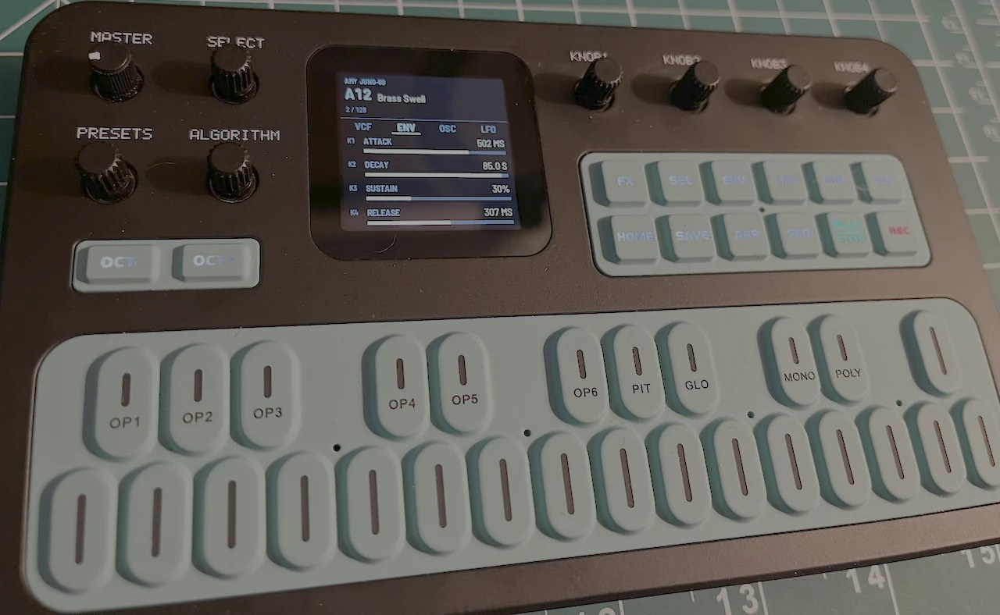
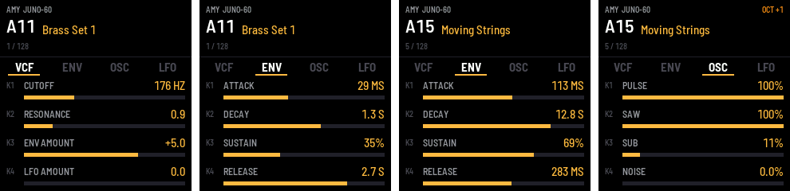

# fm1-amy: a Juno-60 synth for the M-VAVE FM-1

fm1-amy turns the M-VAVE FM-1 into a six-voice polyphonic analog-style synthesizer. It replaces
the FM-1's firmware with [AMY](https://github.com/shorepine/amy), a portable synthesizer library,
playing AMY's emulations of the 128 factory patches of the Roland Juno-60, loaded just as the
[AMYboard editor](https://amyboard.com/editor) loads them. Pick a preset with the PRESETS knob,
then shape it with the four knobs, which mirror the editor's patch pane: oscillators, LFO,
filter, envelopes, EQ, chorus, reverb and distortion.
Over USB it is also a MIDI instrument, and it can be edited from the
[AMYboard editor](https://amyboard.com/editor).



> **fm1-amy is experimental.** It has been built, installed and played on one FM-1. Installing
> it replaces the FM-1's own firmware and is at your own risk. An FM-1 that keeps crashing at
> start-up drops into a safe mode from which other firmware can be installed, and M-VAVE's
> firmware can be put back (see [If something goes wrong](#if-something-goes-wrong)).

fm1-amy is built on [X0X](https://github.com/charlesvestal/fm1-x0x), Charles Vestal's groovebox
firmware for the FM-1, itself a fork of [Felucca](https://github.com/hugelton/Felucca) by Leo
Kuroshita (Hügelton Instruments). It keeps their foundations (the hardware layer, USB, the update
loader and installer, the safe mode and the build system) and replaces the instrument entirely:
none of X0X's groovebox is used.

## Playing it



| Control | What it does |
|---|---|
| Keys | Play the patch: 27 keys from F3 to G5, up to six notes at once |
| OCT- / OCT+ | Shift the keys down or up an octave (-2 to +2; shown at the top right of the screen) |
| PRESETS | Choose the preset, A11 to B88: the Juno-60's 128 factory patches (see [Presets](#presets)) |
| SELECT | Choose the page of knobs, one of eleven (the screen shows the pages either side) |
| KNOB1 to KNOB4 | Change the page's settings (shown as K1 to K4 on the screen) |
| MASTER | Volume |

The pages are the sections of the [AMYboard editor](https://amyboard.com/editor)'s patch pane,
and each knob is the editor's: the same name, range and curve, sending the same AMY message, so a
knob on the FM-1 does exactly what the same knob in the editor does. (The editor's LFO also has a
wave selector, which the FM-1 leaves out.)

| Page | K1 | K2 | K3 | K4 |
|---|---|---|---|---|
| OSC A | freq (50 to 2000 Hz) | wave | duty (0.5 to 0.99) | level |
| OSC B | freq (50 to 2000 Hz) | wave | duty (0.5 to 0.99) | level |
| LFO | freq (0.1 to 20 Hz) | osc: pitch depth (0 to 4) | pwm: pulse-width depth (0 to 0.49) | filt: filter depth (0 to 4) |
| VCF | freq (20 to 8000 Hz) | resonance (0.5 to 16) | kbd: keyboard tracking (0 to 1) | env: filter envelope amount (-10 to 10) |
| VCF ENV | attack (0 to 1000 ms) | decay (0 to 2000 ms) | sustain (0 to 1) | release (0 to 8000 ms) |
| ADSR | attack (0 to 1000 ms) | decay (0 to 2000 ms) | sustain (0 to 1) | release (0 to 8000 ms) |
| EQ | low (-15 to 15 dB) | mid | high | |
| CHORUS | level (0 to 1) | freq (0.1 to 20 Hz) | depth (0.01 to 1) | |
| REVERB | level (0 to 1) | live (0 to 1) | damp (0 to 1) | |
| ECHO | level | delay | feedback | (not available: see below) |
| DISTORTION | type | drive (1/16 to 16) | mix (0 to 1) | |

Turning a continuous knob moves it in 128 steps along its range, logarithmically where the
editor's knob is logarithmic. The selectors step through their options one detent at a time:
the oscillators' wave (sine, pulse, saw up, saw down, triangle, noise, PCM, wavetable, algo;
fm1-amy has no samples or wavetables, and "algo" needs FM operators this voice doesn't have, so
the last three aren't useful here) and the distortion type (off, clip, fold, clip+fold, crush,
all).

### Presets

The PRESETS knob loads each Juno-60 preset exactly as the editor's **Load Preset** button does,
so a preset sounds the same on the FM-1 as it does after Load Preset in the editor, and the
FM-1's knobs show the same values as the editor's. The screen shows the new preset at once; the
FM-1 loads it once the knob has rested for 150 ms, so scrolling through doesn't load every preset
on the way.

The editor doesn't load AMY's own Juno patches, which use six oscillators a voice. It loads
AMYboard's default patch (AMY patch 257: four oscillators a voice, the filter and amplifier, the
LFO, Osc A and Osc B, which is what its knobs control) and then sends five messages that set it up
like the Juno patch. In that translation, which approximates the Juno patch:

- OSC A and OSC B are the Juno patch's two loudest sources among its pulse, saw, sub-oscillator
  and noise (usually the pulse and saw), with the Juno's amplifier level folded into their levels;
- the Juno's envelope becomes both the ADSR (the volume) and VCF ENV (the filter, by the VCF
  "env" amount), set the same; in the patches that use the Juno's "gate" mode, it becomes VCF ENV
  only, and the volume just follows the key;
- the LFO is a triangle, and EQ and chorus are as the patch sets them.

Choosing a preset puts the knobs of the first eight pages where the preset sets them, showing its
exact values until you turn a knob, so you start from the factory sound and change it from there.
Reverb and distortion, which no preset sets, keep their settings across presets.

What it doesn't do (yet):

- **Nothing is saved.** Your knob changes last until you choose another patch or switch off.
- **The screen doesn't follow MIDI.** Changes made over MIDI or from the AMYboard editor change
  the sound, but the knob values on the screen stay where they were.
- **The keys stay local.** The FM-1's own keys play at full velocity and aren't sent out over
  MIDI (see [MIDI and the AMYboard editor](#midi-and-the-amyboard-editor)).
- **No echo.** The ECHO page is shown, to match the editor, but does nothing: the FM-1 doesn't have
  the RAM for echo's delay line beside the reverb's (see [How it works](#how-it-works)).
- **Only the Juno presets.** AMY also has 128 DX7 patches, but they are left out to fit the
  FM-1's flash (see [How it works](#how-it-works)).

## MIDI and the AMYboard editor

Over USB the FM-1 is a class-compliant MIDI device, "X0X FM-1" (the name comes from X0X); no
driver is needed. MIDI channel 1 plays the synth, with note velocity, pitch bend and the sustain
pedal (CC 64), so a keyboard or a DAW can play it. Its controllers are AMYboard's, from patch
257's MIDI mappings: CC 7 level, 74 filter freq, 71 resonance, 76 LFO freq, 77 LFO osc depth,
93 chorus level, 73 / 75 / 79 / 72 attack / decay / sustain / release, and 91 reverb level
(CC 94, echo level, does nothing here).

The [AMYboard editor](https://amyboard.com/editor) can edit it live. The editor is made for
[AMYboard](https://amyboard.com), AMY's own hardware, and talks to it in AMY's wire language over
MIDI SysEx; fm1-amy understands enough of that conversation for the editor's synth controls:

1. Open the editor in Chrome or Edge (they have Web MIDI) and choose **control** mode, allowing
   MIDI with SysEx when the browser asks.
2. In the MIDI port settings, choose **X0X FM-1** as both the input and the output. The editor
   picks ports named "AMYboard" by itself, so choose the FM-1 by hand; its warning about the port
   names can be dismissed.
3. The editor's knobs and patch choices for channel 1 now change the FM-1's sound, and its
   on-screen keyboard plays it.

What doesn't carry over: AMYboard runs Python sketches, which the FM-1 can't, so reading a sketch
from the board gets no answer and writing one has no effect (the editor warns first that it
couldn't detect the firmware). Drum kits and DX7 patches don't sound, since fm1-amy has neither
AMY's samples nor its DX7 patches.

How it works: the editor sends each AMY message as SysEx `F0 00 03 45 <message> F7` and waits for
an acknowledgement (`F0 00 03 45 'A' 'K' F7`) before sending the next; it pings with `zI`, to which
the FM-1 answers `OK`. The AMYboard's own commands are acknowledged and otherwise ignored: Python
(`zP`), reboot (`zB`), reading files (`zD`) and samples. A file or sample upload's data chunks are
counted off and dropped, so they can't be read as AMY messages. AMY's own MIDI output goes back
out over USB too.

The FM-1's keys aren't sent out over MIDI by default: in control mode the editor sends what it
receives back to the board, so every note would play twice. To send them (on channel 1), build
with `X0X_AMY_KEYS_OUT=1`.

## Installing

There is no ready-made firmware file yet: [build it](#building) first, which gives
`build/amy_fw/x0x-amy.fwsc`. Then, with the FM-1 plugged in by USB and switched on:

```bash
pip3 install mido python-rtmidi
python3 tools/fm1_install.py --info                       # check the FM-1 is found, and what it runs
python3 tools/fm1_install.py build/amy_fw/x0x-amy.fwsc    # install
```

The installer reads the package and starts the FM-1's update loader, which writes the firmware,
restarts the FM-1 and checks what it runs afterwards. It works from M-VAVE's own firmware
(it was first installed over M-VAVE's V15, which identifies as `FM-1_015`) and from X0X.
Don't unplug the FM-1 or switch it off while it writes. Afterwards the FM-1
reports `FM-1_900`, the identity of a development build, and its USB MIDI port is named
"X0X FM-1".

To go back to X0X, install its firmware from [X0X's web installer](https://charlesvestal.github.io/fm1-x0x/install/),
which can also put M-VAVE's firmware back.

## If something goes wrong

These come from X0X and Felucca, and still work in fm1-amy:

- **Crash:** the screen turns red, shows where the crash happened, and the FM-1 restarts by itself.
  If you report a crash, include that address and what you were doing.
- **Safe mode:** if the firmware crashes twice in a row while starting, the FM-1 starts in safe
  mode instead: no sound, but USB works, so the installer (or X0X's web installer) can reach it.
- **Update mode:** hold OCT- and OCT+ together for five seconds. fm1-amy doesn't show X0X's
  countdown on its screen, but the FM-1 still enters update mode, where an install can finish.
- **Rescue:** if even safe mode fails twice, the chip drops into its own update mode, which only
  `tools/fm1_rescue.sh` can reach (from a Mac). It puts M-VAVE's V15 firmware back; see "Recovering
  an FM-1 that won't start" in [X0X's manual](docs/MANUAL.md).

## Building

fm1-amy builds with X0X's build system and JieLi's toolchain for the FM-1's chip (an AC791N with
a pi32v2 CPU). [BUILDING.md](BUILDING.md) has the details; in short, on a Mac you need:

- **Python 3** with Pillow: `pip3 install Pillow`
- **Docker**, to run JieLi's toolchain, which exists only for x86-64 Linux. Docker Desktop works,
  or Colima: `brew install colima docker && colima start --vm-type vz --vz-rosetta` (Rosetta runs
  the x86-64 toolchain on Apple silicon). On x86-64 Linux the toolchain runs without Docker.
- **JieLi's toolchain**: `tools/get_toolchain.sh` installs it to `~/.jieli/toolchain`.
- **JieLi's AC79 SDK** (Apache-2.0), from which the package takes three files. Clone it to
  `~/fw-AC79_AIoT_SDK`:
  ```bash
  git clone --depth 1 --branch AC79NN_SDK_V1.2.1_2023-12-13 \
      https://gitee.com/Jieli-Tech/fw-AC79_AIoT_SDK.git ~/fw-AC79_AIoT_SDK
  ```
  If gitee.com can't be reached from your network, a GitHub mirror of the same tag works: the
  build checks the three files against their SHA-256 hashes.
- **AMY**: a checkout of [shorepine/amy](https://github.com/shorepine/amy), unmodified. fm1-amy
  was developed against AMY 1.2.200 and the current build is tested with AMY 1.2.204
  (commit `ca31391d`).
  ```bash
  git clone https://github.com/shorepine/amy.git ~/amy
  ```

Then build:

```bash
X0X_AMY=1 AMY_DIR=~/amy ./build.sh        # build/amy_fw/x0x-amy.fwsc
```

`X0X_AMY_PATCH=N` chooses the preset at power-on (0 to 127, default 0 = A11 Brass Set 1).
The build checks the result as X0X's does and fails if anything is out of bounds:

```
  ok    image 319980 B; RAM .data+.bss 80212 B of 98304; pool 332240 B of 344064
```

Without `X0X_AMY=1`, `./build.sh` still builds X0X's groovebox (into `build/`), since this tree
carries X0X's sources unchanged: the AMY build swaps its engine and screen in at build time.

### Updating the presets

The presets are a committed snapshot, `tools/amy_k257.json`: for each Juno patch, the messages the
editor's Load Preset sends. It is made by running the editor's own translation
(`get_wire_commands_for_juno_patch` and the wire-code parser in `tulip/amyboardweb/static/spss.js`
of [tulipcc](https://github.com/shorepine/tulipcc)), unchanged, under Node, with AMY's generated
patch list. Building doesn't need Node or tulipcc; when the editor's translation or AMY's Juno
patches change, check and regenerate the snapshot from a tulipcc checkout:

```bash
node tools/gen_amy_k257.js ~/tulipcc --check    # is the snapshot current?
node tools/gen_amy_k257.js ~/tulipcc            # rewrite tools/amy_k257.json
```

## Trying it without an FM-1

The same code also builds for a computer, which is how most of fm1-amy was developed:

```bash
AMY_DIR=~/amy sh host/build_host_amy.sh                          # build/host/x0x_amy_host
build/host/x0x_amy_host host/amy_pages.x0x OUTDIR                # runs a script, writes WAVs and screenshots
```

The simulator runs the whole firmware against a simulated FM-1 driven by a script of key presses
and knob turns (`host/amy_*.x0x`; the commands are listed at the top of `host/x0x_host.c`), and
writes the audio and the screen to files. At the end it prints how many instructions per sample
the synth took, a guide to whether a change still fits the FM-1's CPU. Scripts can send MIDI in
too (`midi 90 3C 64`, or `sysex i1v0F200Z` for an AMY message as the editor sends it), and the
MIDI going out is written to `midi_out.txt`; `host/amy_midi.x0x` tests the editor's protocol.

In a browser:

```bash
AMY_DIR=~/amy sh web/emu/build_amy.sh                            # needs Emscripten (brew install emscripten)
python3 -m http.server 8000 --directory build/emu_amy            # then open http://localhost:8000/
```

That's X0X's browser emulator running fm1-amy: click the knobs and keys on the picture of the
FM-1, use the mouse wheel over a knob to turn it, or play the white keys from the computer
keyboard (`q` to `i`, `a` to `k`). The page's text still describes X0X.

## How it works

**AMY in place of X0X's engines.** X0X renders its parts in the FM-1's audio interrupt, 256
stereo frames at 44.1 kHz at a time. fm1-amy hands that same call to AMY
(`firmware/src/app/engine_amy.c`), which renders one 256-sample block of synth 1: patch 257,
set up as a Juno preset, with six voices. Everything that touches AMY runs in that interrupt: the keys are read there and
become note messages, and the screen's knob changes reach it through a queue, so the main loop
(the screen, USB) never races the synth. The AMY build leaves out X0X's `engine.c` and its 909,
808, 303 and break engines; `engine_amy.c` stands in for them.

**The screen** (`firmware/src/app/ui_amy.c`) replaces X0X's. Its knob table is the AMYboard
editor's (`amy_parameters.js` in tulipcc's `tulip/amyboardweb/static/`): each knob's name, range,
curve and AMY message template, sent for synth 1. The editor's knobs control AMYboard's default
patch, 257, which is what the FM-1 runs too. A message to the synth naming an oscillator changes
that oscillator in every voice. `tools/gen_amy_juno.py` turns the preset snapshot into a table:
each preset's name, its messages, and the knob values those messages set. When a preset is
chosen, the audio interrupt sends AMY the editor's base message (`K257i1iv6`: patch 257 on synth 1
with six voices) and then each of the preset's messages, as the editor does.

**Fitting the FM-1.** The firmware has 568 KB of flash, 96 KB of RAM for the program's data and
a 336 KB pool for large buffers.

| | fm1-amy | X0X, for comparison |
|---|---|---|
| Firmware image | 320 KB | 480 KB |
| Program data (RAM) | 80 KB | 98 KB |
| Pool (fm1-amy: AMY's 256 KB heap, the screen's 69 KB canvas, backup buffers) | 332 KB | 336 KB |

To fit, `tools/prep_amy_src.py` copies AMY's sources into the build tree with only patch 257 (the
Juno presets come from the snapshot; no DX7 patches) and without AMY's built-in drum samples.
AMY itself is not modified. AMY needs about 120 KB of heap with six voices and chorus (measured
with AMY's own six-oscillator Juno voices; patch 257's four need less), and the reverb adds 138 KB when
its level is first raised (measured on a Mac; the delay lines are the same size on the FM-1).
Echo would add another 98 KB (for delays up to 185 ms) to 295 KB (AMY's default 743 ms maximum),
which doesn't fit beside the reverb, so fm1-amy builds AMY without echo. If the reverb's own
allocation ever failed, AMY leaves it off rather than stopping.

**The C library.** JieLi's toolchain comes with a reduced C library that has neither `malloc`
nor `printf`. `firmware/src/app/amy_libc.c` provides them for the FM-1: a simple allocator over
the heap in the pool, and an integer-only `printf` family (AMY prints floating-point numbers only
in diagnostics, which the FM-1 doesn't show). The FM-1's FPU is single precision, and X0X's build
fails if any double-precision arithmetic is linked; the fm1-amy build allows only AMY's float to
double conversions, which happen in diagnostics and when a patch loads, never per sample.

**CPU.** Measured in the simulator (instructions per sample on a Mac: a comparison, not an FM-1
figure), six held voices take about 940, against about 1,150 for X0X playing its demo pattern,
which X0X splits across the FM-1's two cores; fm1-amy renders on one. The reverb adds about a
fifth (the worst block of six held voices goes from 1,065 to 1,266). The load on the FM-1
itself hasn't been measured yet.

## Next steps

- Save edited patches, and recall them.
- Show changes that arrive over MIDI on the screen, and send the knobs out as MIDI.
- Show the audio load, and use the FM-1's second core.
- Bring back the DX7 patches, loaded as the editor loads them, if they can be made to fit.
- In AMY: build options for leaving out patch banks and samples, and single-precision constants
  throughout, so neither the trimming step nor the build-check exception is needed.

## Credits

- [AMY](https://github.com/shorepine/amy), the synthesizer, by Brian Whitman and Dan Ellis
  (shorepine), including its emulation of the Juno-60 and its factory patches.
- The [AMYboard editor](https://amyboard.com/editor), in
  [tulipcc](https://github.com/shorepine/tulipcc) (shorepine, MIT): fm1-amy's knobs are its patch
  knobs, and its presets are made by its Juno preset translation.
- [X0X](https://github.com/charlesvestal/fm1-x0x) by Charles Vestal, which fm1-amy is built on:
  its hardware support, simulator, browser emulator, installer and build checks are all here.
- [Felucca](https://github.com/hugelton/Felucca) by Leo Kuroshita (Hügelton Instruments), the
  FM-1 firmware X0X is a fork of: the hardware layer, USB, the update loader and installer, and
  the storage.
- [FM-1-RE](https://github.com/AL-255/FM-1-RE), which documents the FM-1's chip, firmware and
  update protocol.
- X0X's use of the FM-1's second core follows keremimo's [Melodee](https://github.com/keremimo/melodee)
  and zednaked's [Jangada](https://github.com/zednaked/jangada).
- The screen font is Barlow Semi Condensed (The Barlow Project Authors, SIL OFL 1.1).

## Licence

fm1-amy is free software under the GNU General Public License, version 3 only
(`GPL-3.0-only`, full text in [LICENSE](LICENSE)), the licence of X0X and Felucca. If you
distribute the firmware, you must give your recipients its complete source under the same
licence. AMY is under the MIT licence and is compiled into the firmware from your AMY checkout;
it isn't part of this tree. [LICENSING.md](LICENSING.md) lists where each part of the code comes
from. The tree also still carries X0X's groovebox sources and its other assets, under their own
terms as listed there.

M-VAVE and FM-1 are trademarks of their owners; Juno-60 is a trademark of Roland Corporation,
used here only to describe the patches AMY emulates. fm1-amy isn't affiliated with or endorsed
by M-VAVE, Roland, Hügelton Instruments or the authors of X0X.
